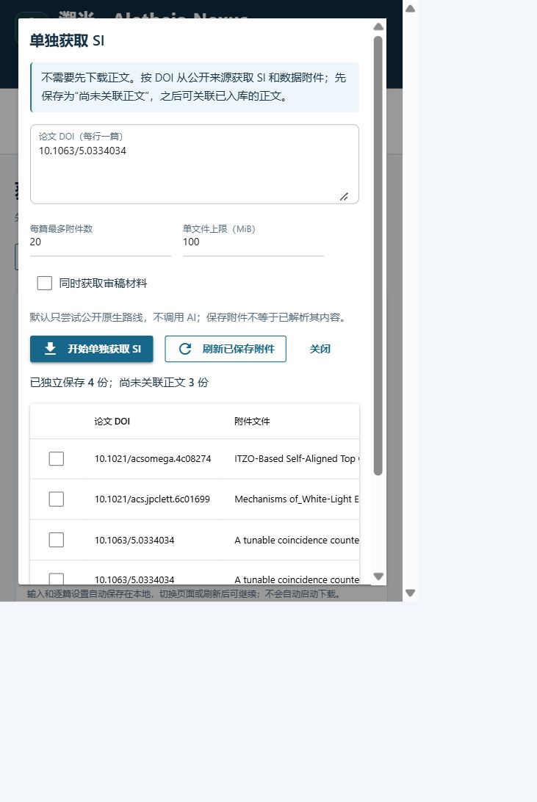

# Native SI without a main PDF: failed-case retest (2026-11-04)

[中文](SI_INDEPENDENT_20261104.md)

**Independent SI is implemented, and two metadata-closed AIP cases that previously failed even the standalone native probe now deliver real files.** The four earlier ACS/Springer probe successes also work through product entry points. This does not establish universal publisher/non-OA coverage. The five historical difficult cases remain unresolved.

Product source is frozen at `c7617eb5809d97552998f0a974ece4afba391ac9`, branch `feat/si-independent-acquisition`, development version 0.8.2. No main-branch merge or package release is performed.

## Cause and implementation

The existing workflow attempted SI only after verifying a main PDF. A public supplement could therefore remain `NOT_ATTEMPTED` when the main text failed. A diagnostic probe could establish delivery, but was not a product feature. Another concrete gap was support for ACS Figshare without equivalent AIP/Royal Society official portals: a blocked article page hid an available public route.

- Shared `StandaloneSupplementService` queries applicable PMC metadata/XML, official manifests and explicit article-page links by DOI, without downloading or fabricating a main PDF or VERIFIED record.
- CLI adds `si acquire`, `si list`, `si attach`; acquisition/library UI adds the independent SI dialog; MCP adds `si_only=true` to `acquire_documents`. They reuse the same service, file validation and path preferences.
- Shared Figshare rules support official ACS, AIP, Royal Society and Taylor & Francis portals. Checks bind exact parent DOI, available parent-title constraints, official portal, supplement DOI/record ID, public/non-embargoed state, file ID, size and MD5. Redirects are confined to the corresponding publisher bucket and file. AIP's observed removal of spaces from storage filenames is handled without relaxing ID/content/hash checks. Arbitrary Figshare/S3 locations remain unauthorized.
- DOI-only ACS uses the official registry's parent title so auxiliary metadata rate limits cannot prevent SI lookup; supplied titles still constrain identity. Independent PMC retains version, DOI, OA/retraction, XML and file checks without claiming main-text verification.
- Files and immutable DOI receipts live under `<library>/SI/independent/`. SI, source data, reporting summaries and peer review retain distinct roles. Entries are `DOI_ONLY`, main status `NOT_REQUESTED`, without ARTICLE/parser identity. A later real main paper can receive a checked linked copy while originals/receipts remain intact. Successful normal main-text acquisition also attempts linking cached same-DOI attachments.

See [workbench/CLI instructions](WORKBENCH_USER_GUIDE.en.md#independent-si-without-the-main-text) and [MCP mode and separate authorization](V08_ENTRYPOINTS.en.md#independent-public-si-without-a-main-pdf). Failed normal main-text jobs do not automatically switch modes.

Official hosting documentation: [AIP author instructions](https://publishing.aip.org/resources/researchers/author-instructions/), [Royal Society author guidelines](https://www.royalsociety.org/journals/authors/author-guidelines/), [Taylor & Francis supplemental materials](https://authorservices.taylorandfrancis.com/publishing-your-research/writing-your-paper/enhancing-your-article-with-supplementary-material/). These establish legitimate public hosting routes, not SI existence or reliable network delivery for every article.

## Frozen live protocol

Retest all 54 metadata-closed papers and four OA controls from the [previous corpus](SI_NON_OA_BENCHMARK_20261103.en.md), plus five exposed historical difficult cases and four exposed Royal Society OA regressions: 67 papers. **Only DOI is supplied to the product CLI**, without known SI URLs, answer titles or main PDFs. Stored titles/prior evidence are comparison data only. Added cases are exposed regressions, not independent holdouts or non-OA examples.

[Manifest](../benchmarks/si_independent_20261104/manifest.json) SHA-256: `7a9bc9c512901cd6a1b669e2e64fefd8462688465484d55e097e376374d1f8c9`; original 54+4 manifest remains `6b479b1f1c724ae9da929a6c3876256b57ce9fe94fe60e256a42e6d53bd53ef1`.

Each child invokes the real `si` CLI from Windows `C:\Windows\System32`, using a fresh library. Public native HTTP only, with no login, browser session, institutional/API credentials or AI. Limits: 20-second requests, 200 seconds per paper, 20 files per paper, 100 MiB per file, four workers and a 5 GiB disk budget. All 67 ran, without process timeouts or budget skips. The HTTP observer records redacted requests without replacing transport/content.

## Actual failure-to-success cases

| DOI | Previous independent native probe | New product delivery | Route |
| --- | --- | --- | --- |
| `10.1063/5.0326264` | Article-page 403; no files | DOCX, 3,012,524 bytes | Official AIP Figshare |
| `10.1063/5.0334034` | Article-page 403; no files | PDF 495,673 + ZIP 103,861 bytes | Official AIP Figshare; multiple records/files |

These are new public-route gains. Four other DOIs—`10.1021/acsami.6c06732`, `10.1021/acs.jpclett.6c01699`, `10.1007/s11056-026-10197-y`, `10.1007/s43450-026-00780-x`—already delivered through the diagnostic probe, but were blocked by the product's main-PDF prerequisite. They now save through the independent product entry point; they are not four additional network breakthroughs.

An initial new-entry attempt for `acs.jpclett.6c01699` failed because Crossref rate limiting left no title. Using the official registry parent title fixed it. Saved SHA-256: `669a1ad6de1f9ab44089507ab5fedaaab75803cfe27519f19d728a883dcbb655`. The failed attempt is retained.

## Complete batch observations

| Group | Papers | COMPLETED / PARTIAL / FAILED | Saved files |
| --- | ---: | --- | ---: |
| Original metadata-closed sample | 54 | 6 / 0 / 48 | 7, all SI |
| Original OA controls | 4 | 4 / 0 / 0 | 20, with source data separately tagged |
| Royal Society OA regressions | 4 | 3 / 1 / 0 | 4, each paper has actual SI |
| Historical difficult cases | 5 | 0 / 0 / 5 | 0 |

**31 files: 20 SI and 11 source-data files**, covering PDF, DOCX, ZIP, PNG, XLSX, XLS and CSV. Source data/peer review are not added to SI counts. All file SHA-256, DOI, receipt-identity and format checks pass; available publisher MD5/size are checked. No ARTICLE identity, fabricated main sidecar or leftover `.part` exists. See [machine audit/file hashes](validation/si-independent-20261104.json) and [per-case table](validation/si-independent-cases-20261104.csv).

The three Royal Society gaps previously delivering only peer-review material now deliver PDF, DOCX and CSV. For `10.1098/rspb.2022.1062`, the additional ZIP is 193,367,083 bytes: the 100 MiB batch correctly skips its download and reports PARTIAL. A separate **installed-CLI test in a new library at 256 MiB** delivers both the 1,051,964-byte PDF and ZIP with valid checksums. It does not replace the original capped batch score.

The remaining 48 closed cases comprise 32 blocked HTTP pages, nine interaction-required pages, three pages with unconfirmed identity and four with no supported explicit attachment found. Some auxiliary metadata requests also hit rate limits. These outcomes do not prove subscription-only SI. Metadata closed is not an independently confirmed SI-existence gold standard: **6/54 is an observed delivery count, not complete-SI retrieval accuracy**, and the other papers cannot be assumed to lack public SI.

Historical difficult cases remain unresolved:

| DOI | Observed blocker |
| --- | --- |
| `10.1002/cctc.202201687` | Wiley HTTP 403 |
| `10.1039/d4cc01176g` | RSC HTTP 403, no independently validated manifest |
| `10.1007/s11814-019-0365-0` | Identity confirmed; no supported SI link found; SI existence unconfirmed |
| `10.3390/nano13050931` | MDPI response does not confirm article identity |
| `10.1016/j.elecom.2022.107204` | linkinghub intermediary does not confirm article identity |

Filename guessing or weaker identity checks cannot turn these into claimed successes.

## Engineering, installation and UI verification

- 65 added automated cases cover independent storage/reuse/binding, preventing SI promotion to ARTICLE, relocated-library reading, DOI/title conflicts, corruption/path boundaries, caps/partial delivery, peer-review opt-in, PMC version gates, official portals/buckets/file scope and distinct MCP grants.
- Final full suite: **4243 passed, 148 skipped, zero failures, 302.13 seconds**; [full log](validation/si-independent-pytest.txt). Skips remain environment-dependent browser/OCR/symlink checks and are not passes.
- Initial full suite: 4205 passed, one failed, 148 skipped because new backend literal errors lacked Chinese explanations. After localization, intermediate source passed 4212; the final publisher rules passed the full suite again. [Initial failure log](validation/si-independent-pytest-initial.txt) is retained; assertions were not weakened.
- Isolated wheel installation: **186 related tests passed from System32**, [installed log](validation/si-independent-installed-pytest.txt). All 231 Python source files match the frozen source byte-for-byte. Wheel SHA-256: `2488054bd2522615688b37d5ed67f7098e32029d1884b58000b021845a62faa8`. The installed console entry additionally downloaded the three files from both AIP papers and completed the Royal large-file test.
- Installed official MCP SDK stdio verified the `si_only` schema, separate grant preview and no download without approval. Automated tests cover the granted shared service and one-use authorization. No institutional MCP session is claimed tested.
- Windows UI submitted non-OA acquisition, refreshed results, retried missing files and linked independently saved ACS OA SI to a **real imported main-paper copy**. Original main/source and independent SI/receipt hashes remain unchanged; the linked copy is `SUPPLEMENT / local_declared`, without promotion to verified ARTICLE. Libraries, workspace and preferences were isolated from user path settings.
- One ACS redirect returned 403 in an intermediate batch, and the first UI AIP attempt saved only the ZIP. Those failures remain recorded. Retrying the DOI saved the missing PDF and reused the ZIP without overwriting originals; retry success is not described as first-attempt completeness.

Raw outputs: `F:/AI4S/outputs/AN_SI_INDEPENDENT_20261104/`; frozen final batch, HTTP/CLI records, files and additional checks are in `final/`. Reproduce with `scripts/benchmark_si_closed.py` in `standalone_si` mode and audit with `scripts/summarize_si_independent.py`. Fresh network results may vary.

Primary changes: `si_cli.py`, `workbench/standalone_supplements.py`, `supplements.py`, `supplement_figshare.py`, `supplement_repositories.py`, `library.py`, `ui_supplements.py`, UI entry/labels, `content/local.py`, `research_acquisition.py`, `mcp_server.py` and tests. README, workbench manual, CLI/MCP guide and baseline report are updated in Chinese/English.

Assessment: **ready to merge this independent-SI feature and official-hosting enhancement**, without claiming universal SI coverage. No database rewrite, institutional-access bypass or replacement of main-text acquisition policy.
