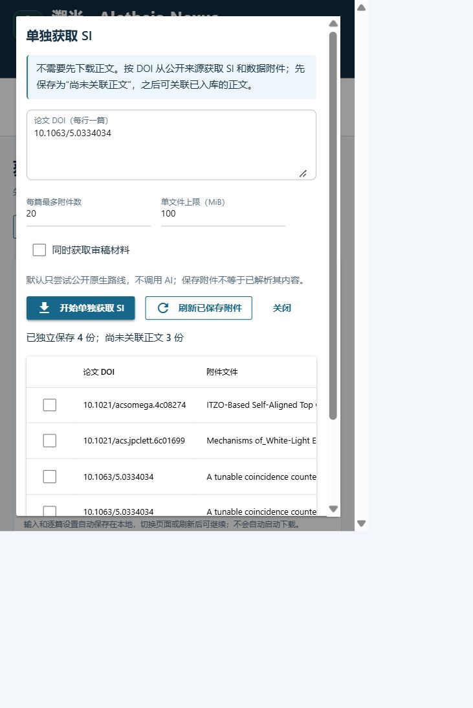

# 无需正文的原生 SI 获取与失败样本复测（2026-11-04）

[English](SI_INDEPENDENT_20261104.en.md)

**已实现独立 SI 获取，并将两篇原先独立原生探测也失败的 AIP 非 OA 样本转为真实文件交付。** 原有四篇 ACS/Springer 探测成功案例现在也能通过产品入口独立保存。没有声称所有出版社、所有非 OA 论文的 SI 都已可取；先前五篇历史疑难样本仍未成功。

产品源码冻结为 `c7617eb5809d97552998f0a974ece4afba391ac9`，分支 `feat/si-independent-acquisition`，版本仍为开发中的 0.8.2。此次不合并主线、不发布安装包。

## 根因与改动

原流程在正文核验后才进入 SI 阶段，所以未取得正文时，即使 SI 公开也会是 `NOT_ATTEMPTED`。独立探测脚本能证明公开文件可交付，但并不是产品能力。另一个真实缺口是只适配 ACS 官方 Figshare，未查询 AIP、Royal Society 等官方附件仓库；文章页 403 因而遮住了另一条公开入口。

- 增加共享 `StandaloneSupplementService`，按 DOI 查询适用的 PMC 元数据/XML、官方托管清单和文章页明确链接，不下载正文，不伪造正文 PDF 或 `VERIFIED` 记录。
- CLI 增加 `si acquire`、`si list`、`si attach`；UI 在获取页、文库页增加独立 SI 窗口；MCP 在原 `acquire_documents` 增加 `si_only=true`。三者复用相同服务、文件校验及路径配置。
- 复用 Figshare 规则支持 ACS、AIP、Royal Society、Taylor & Francis 的官方门户。要求精确父 DOI、父题名约束、官方门户、补充材料 DOI/记录编号、公开且未禁运、文件编号/大小/MD5。只允许对应文件和出版社存储桶的重定向；AIP 存储名删除空格的实际情况单独处理，仍核对编号、内容和哈希。没有开放任意 Figshare 或 S3 地址。
- DOI-only ACS 允许使用官方清单提供的父题名，辅助元数据限流不再阻断 SI 查询；原已知父题名流程仍保留严格比对。PMC 独立入口仍检查版本、DOI、撤稿/OA 状态、XML 和文件校验，不声称已验证正文。
- `<文库>/SI/independent/` 保存文件及不可覆盖的 DOI 来源记录，角色区分 SI、源数据、报告摘要、审稿材料。独立附件为 `DOI_ONLY`、正文 `NOT_REQUESTED`，不进入 ARTICLE 登记或直接解析；真实正文后来入库后，可重新核对并生成关联副本，保留独立原件及来源。普通正文成功时也会尝试关联已保存的同 DOI 附件。

用户操作、CLI 参数见[工作台手册](WORKBENCH_USER_GUIDE.md#无需正文独立获取-si)，MCP 范围与独立一次性授权见[CLI/MCP 说明](V08_ENTRYPOINTS.md#独立获取公开-si无需正文)。原正文失败任务不会自动转换为新模式。

官方托管依据：[AIP 作者说明](https://publishing.aip.org/resources/researchers/author-instructions/)、[Royal Society 作者说明](https://www.royalsociety.org/journals/authors/author-guidelines/)、[Taylor & Francis 补充材料说明](https://authorservices.taylorandfrancis.com/publishing-your-research/writing-your-paper/enhancing-your-article-with-supplementary-material/)。这些说明支持使用公开托管路线，不保证任意论文都有 SI 或每次网络请求均成功。

## 冻结实测协议

延续[上一轮非 OA 清单](SI_NON_OA_BENCHMARK_20261103.md)的全部 54 篇 closed 元数据样本和 4 篇 OA 对照，另加 5 篇已暴露的历史疑难样本与 4 篇 Royal Society OA 对照，共 67 篇。输入产品 CLI 的**只有 DOI**，未提供已知 SI URL、题名答案或正文；清单内原题与旧证据仅用于对照。后加样本属于暴露的回归集，未当成独立留出集或非 OA 样本。

[冻结清单](../benchmarks/si_independent_20261104/manifest.json) SHA-256：`7a9bc9c512901cd6a1b669e2e64fefd8462688465484d55e097e376374d1f8c9`。旧 54+4 清单哈希保持 `6b479b1f1c724ae9da929a6c3876256b57ce9fe94fe60e256a42e6d53bd53ef1`。

所有子进程从 Windows `C:\Windows\System32` 运行实际 `si` CLI 入口，逐篇全新文库。仅公共原生 HTTP，无登录、浏览器会话、机构/API 凭据或 AI。请求超时 20 秒、单篇 200 秒、每篇最多 20 文件、每文件 100 MiB、4 并发、5 GiB 总磁盘预算。67 篇全部执行，无进程超时或预算跳过。HTTP 观察器只记录脱敏请求，不替换传输或内容。

## 原先失败转为成功

| DOI | 旧独立原生探测 | 新产品实际交付 | 路线 |
| --- | --- | --- | --- |
| `10.1063/5.0326264` | 文章页 403，无文件 | DOCX，3,012,524 字节 | AIP 官方 Figshare |
| `10.1063/5.0334034` | 文章页 403，无文件 | PDF 495,673 字节 + ZIP 103,861 字节 | AIP 官方 Figshare，多记录、多文件 |

这两篇是新增公开路线带来的真实交付增量。另四篇 `10.1021/acsami.6c06732`、`10.1021/acs.jpclett.6c01699`、`10.1007/s11056-026-10197-y`、`10.1007/s43450-026-00780-x`，此前探测已经交付，旧产品却因无正文而未开始 SI；本轮通过正式独立入口保存。不能把这四篇也说成新增网络获取突破。

首次新入口测试中 `acs.jpclett.6c01699` 因 Crossref 限流没有可用题名而失败，修复为从官方清单核对父题名后成功，文件 SHA-256 为 `669a1ad6de1f9ab44089507ab5fedaaab75803cfe27519f19d728a883dcbb655`。原失败输出保留。

## 完整批测结果

| 分组 | 篇数 | COMPLETED / PARTIAL / FAILED | 实际文件 |
| --- | ---: | --- | ---: |
| 原 closed 元数据样本 | 54 | 6 / 0 / 48 | 7，均为 SI |
| 原 OA 对照 | 4 | 4 / 0 / 0 | 20，含单独标记的源数据 |
| Royal Society OA 回归 | 4 | 3 / 1 / 0 | 4，均有真正 SI |
| 五篇历史疑难样本 | 5 | 0 / 0 / 5 | 0 |

共保存 **31 份文件：20 份 SI、11 份源数据**，包含 PDF、DOCX、ZIP、PNG、XLSX、XLS、CSV 七种实际格式。没有把源数据或审稿文件合计为 SI 数。逐份文件的 SHA-256、DOI、receipt 身份、格式门禁全部通过；有官方 MD5/大小的逐项核对，无 ARTICLE、伪造正文 sidecar 或遗留 `.part`。[机器结果和文件哈希](validation/si-independent-20261104.json)、[逐篇表](validation/si-independent-cases-20261104.csv)保留完整口径。

Royal Society 三篇先前只有审稿材料的缺口现已取得对应 PDF、DOCX、CSV。`10.1098/rspb.2022.1062` 的额外 ZIP 为 193,367,083 字节，100 MiB 默认上限下未开始下载，明确 `PARTIAL`；另用**新文库、256 MiB 上限的已安装 CLI**复测，PDF 1,051,964 字节与 ZIP 均成功，校验通过。该补测不替换原 100 MiB 批测分数。

48 篇 closed 未交付：32 篇页面 HTTP 访问受阻、9 篇需交互页面、3 篇页面身份未确认、4 篇未发现支持的明确附件。部分请求还出现辅助元数据限流；这不等于 SI 被订阅锁定。样本仅以元数据 closed 分层，未逐篇确认“确有 SI”，因此 **6/54 是交付观察数，不是全部 SI 获取成功率**，也不能据此推断其余论文没有公开 SI。

五篇历史疑难样本仍未恢复：

| DOI | 本轮实际阻断 |
| --- | --- |
| `10.1002/cctc.202201687` | Wiley 页面 HTTP 403 |
| `10.1039/d4cc01176g` | RSC 页面 HTTP 403，未取得可核验的独立附件清单 |
| `10.1007/s11814-019-0365-0` | 页面身份通过，但没有发现支持的 SI 链接；未证实存在 SI |
| `10.3390/nano13050931` | MDPI 返回页不能确认论文身份 |
| `10.1016/j.elecom.2022.107204` | linkinghub 中间页不能确认论文身份 |

不能用文件名猜测或放宽身份门禁把这些状态改成成功。

## 工程、安装及界面验证

- 新增 65 项自动化用例，覆盖独立保存/复用、后续绑定、禁止 SI 伪装正文、目录迁移后读取、错误 DOI/题名、篡改/越界、文件上限、部分成功、审稿选项、PMC 版本门禁、官方门户/存储桶/文件边界及 MCP 模式独立授权。
- 最终全套：**4243 passed，148 skipped，零失败，302.13 秒**。[完整输出](validation/si-independent-pytest.txt)。148 项跳过不计通过，沿用浏览器/OCR/符号链接权限等环境条件。
- 首轮全套曾为 4205 passed、1 failed、148 skipped，失败是新后端字面量尚未全部提供中文诊断；修复后中间源码为 4212 passed，最后增加出版社规则后再次完整回归通过。保留[首轮失败](validation/si-independent-pytest-initial.txt)，未降低测试断言。
- wheel 安装至隔离目录，从 System32 跑相关测试 **186 passed**，[安装包测试](validation/si-independent-installed-pytest.txt)。wheel 的 231 个 Python 源文件与冻结源码逐字节一致；SHA-256 为 `2488054bd2522615688b37d5ed67f7098e32029d1884b58000b021845a62faa8`。真实已安装控制台入口再次完成两篇 AIP 的三文件下载，以及上述 Royal 大文件补测。
- 已安装 MCP 官方 SDK stdio 往返验证 `si_only` 参数、独立授权预览、无批准不下载；授权后共享服务及一次性批准的行为由自动化测试覆盖。没有冒充已测试带机构登录的 MCP 获取。
- Windows 工作台实际提交非 OA SI 任务、刷新列表、重复补取、选中附件，并将已独立保存的 ACS OA SI 关联到**真实已入库正文副本**。核对原正文/原来源、独立 SI/receipt 哈希不变，关联副本为 `SUPPLEMENT / local_declared`，没有升级为正文核验。UI 测试使用隔离文库、工作区及偏好配置，没有改用户数据路径。
- 出现过一次 ACS 下载重定向 403，以及 UI 第一次 AIP 获取仅交付 ZIP 的部分失败；失败任务和文件结果保留。相同 DOI 再补取成功，已有 ZIP 复用，未覆盖原件；不把重试成功描述为首轮全成。

原始输出：`F:/AI4S/outputs/AN_SI_INDEPENDENT_20261104/`；最终冻结批测、HTTP 记录、CLI 输出、文件及补测在 `final/`。复现实测使用 `scripts/benchmark_si_closed.py` 的 `standalone_si` 模式，复核使用 `scripts/summarize_si_independent.py`；重新联网的结果可能随源站条件变化。

主要代码：`si_cli.py`、`workbench/standalone_supplements.py`、`supplements.py`、`supplement_figshare.py`、`supplement_repositories.py`、`library.py`、`ui_supplements.py`、UI 入口/标签、`content/local.py`、`research_acquisition.py`、`mcp_server.py` 及对应测试。README、工作台手册、CLI/MCP 说明和基线报告已同步中英文。

判断：**达到本轮独立 SI 功能及官方托管路线增强的合并条件**；不代表所有出版社 SI 全覆盖。没有数据库重构、机构权限绕过或正文获取策略替换。
